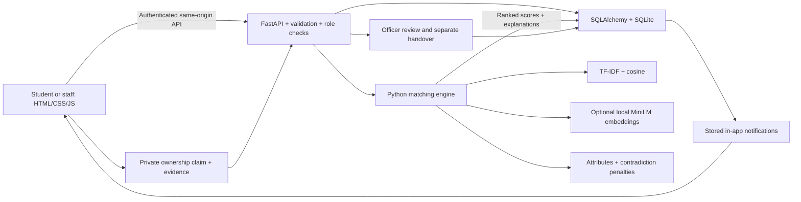
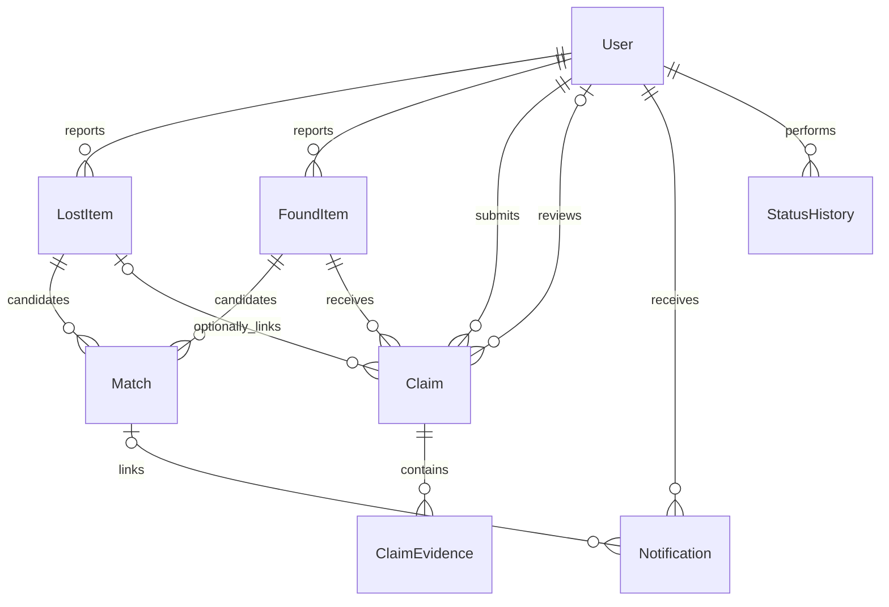

# Findly architecture and matching

## End-to-end flow

Report creation, match records and notifications are committed through the backend. Both lost-first and found-first reporting run the same engine against all active opposite-type reports. A browser refresh is not required to trigger matching. The signed-in frontend polls every 15 seconds when it is safe to refresh without interrupting a form; it also reloads data after actions. No matching percentages are calculated in JavaScript.

## Database relationships

The eight supplied domain entities are retained:

`User` adds password_hash, campus, account_status and auth_version. Emails are case-insensitively unique. Public registration cannot choose an officer/admin role. Passwords use salted PBKDF2-SHA256 (600,000 iterations); legacy 310,000-iteration hashes are adopted and upgraded after login.

Reports retain the ERD's reporter, category, description, colour, brand, location, date, image_ref and status fields. They add title and timestamps. `FoundItem.storage_location` supports officer handover; `image_refs` stores a small JSON gallery of opaque photo names while `image_ref` preserves the original primary-photo field. This keeps the university schema compact without introducing an extra gallery entity.

`Match` has a unique lost/found pair, a numeric score, JSON score_components, match_status and review_status. Recalculation updates a pair rather than inserting duplicates. Unavailable pairs become inactive. Recalculation retains claim and audit records.

`Claim` stores claimant, found item, optional linked lost item, statement, reviewer, decision and decision date. The optional lost link is checked to belong to the claimant; it prevents recovery from closing unrelated reports. `ClaimEvidence` holds private_description, protected proof reference and reviewer_notes. Only the claimant and authorized officers/admins can retrieve its details or files. A finder gains no evidence access merely by reporting an item.

`Notification` retains recipient, event type, message, delivery channel, sent status and timestamp, and adds read_at and optional match_id. A unique `(recipient_id, match_id, event_type)` constraint prevents repeated match alerts even if recalculation is run repeatedly. Other events such as claim decisions use null match_id and remain separate messages.

`StatusHistory` retains related_record_type/id, old/new state, actor, timestamp and reason. The type/id pair is a polymorphic reference maintained by workflow code; actor_id is a real User foreign key. SQLite foreign-key enforcement is enabled. Historical migration data is preserved, including the prototype's additional tables.

## Matching formula

Every active lost report is compared only with active found reports (`status=reported`). Scores are ranked descending and suggested when score >= MATCH_THRESHOLD (default 45). Scores are **similarity suggestions**, not calibrated ownership probabilities.

For each pair:

1. Normalize case and punctuation, then apply contextual phrase mappings.
2. Fit scikit-learn TF-IDF over the lost description/title and current found candidates, with word unigrams/bigrams. Compute cosine similarity between the lost and each found vector.
3. If the real local sentence model is available, compute normalized embedding vectors for the raw title/description and their cosine similarities.
4. Compare item name/type, category, colour, brand, location and date.
5. Add weighted component points, subtract contradictions, clamp to 0–100, and store components, penalties, reasons and active mode.

| Component | Semantic mode | Fallback mode |
| --- | ---: | ---: |
| TF-IDF description/title cosine | 20 | 40 |
| MiniLM sentence cosine | 30 | 0 |
| Item name / recognized type | 10 | 20 |
| Category | 10 | 10 |
| Colour | 10 | 10 |
| Brand | 5 | 5 |
| Location | 10 | 10 |
| Date | 5 | 5 |
| Total before penalties | 100 | 100 |

Missing attributes earn zero points. The date component decays linearly over 30 days; a found date more than two days before the reported loss sets the total to zero. Strong conflicting item types subtract 40 points and cap the total at 20; conflicting colours subtract 22, different stated brands 15, different categories 10, and materially different capacities 15. These transparent initial heuristics should be tuned using labelled campus examples before any evaluation claims.

Synonyms include school bag/rucksack/backpack and drinking bottle/water container/flask in drinking contexts. “Rose” means pink only in an explicit colour field or colour phrase; a laboratory flask is not automatically a drinking bottle. Colour families are deliberately approximate. Locations use lexical campus zones such as library/study area; no geospatial distance or map API is claimed. Explanations therefore say “Similar location descriptions.”

## Explaining the AI to a lecturer

**TF-IDF** gives more weight to distinctive words than common words. **Cosine similarity** compares the direction of two text vectors: more aligned vectors have more similar descriptions. **Sentence embeddings** represent short descriptions as learned numerical vectors and can connect different wording with related meaning. Structured attributes and contradiction penalties add understandable campus-specific evidence.

The tested optional model is `sentence-transformers/all-MiniLM-L6-v2`, revision `1110a243fdf4706b3f48f1d95db1a4f5529b4d41`. It produces 384-dimensional vectors; Findly truncates inputs at 256 wordpiece tokens. It runs locally on CPU, uses safetensors, disables remote model code, and loads only already-downloaded files at runtime. Descriptions are not sent to an external AI service. The explicit model preparation command requires internet access for public weights.

The model is pretrained for short English text. It is not trained on this campus, may misunderstand local names or other languages, and cannot establish identity or ownership. TF-IDF scores depend partly on the current candidate corpus, so adding reports can change existing scores. The system recalculates and stores the resulting values; the UI does not promise stable or perfect scores. Matching currently scans active pairs and is suitable for a local prototype, not a large-scale deployment benchmark.

Photographs are evidence for people to inspect. **No image recognition, face recognition, image embeddings, email/SMS delivery, or automatic ownership approval is implemented.**

## Verification and recovery

User-facing Pending corresponds to `submitted`; More Information Required to `more_information`; Approved and Rejected use their corresponding backend values. Recovery adds `completed`, displayed as Recovered. Report `returned` is also displayed as Recovered.

An officer requests further information or records an approval/rejection with notes. Additional claimant evidence returns the claim to Pending. Approval reserves the found item and removes it from active suggestions. A later, explicit officer handover changes it to returned and completes the approved claim. Only the claim's linked lost report closes. Competing or unrelated claims cannot bypass the reservation and decision rules.

Private files are outside static routes and are fetched through authorization checks. Images are bounded and re-encoded; evidence PDFs are delivered as attachments. Signed HttpOnly SameSite cookies, same-origin mutation headers, session revocation, login rate limiting, explicit role dependencies and privacy-aware response serializers support the local application. These are implemented application controls, not a claim of an external security audit.
